# 🖐️ Carpal Tunnel Syndrome (CTS) Diagnosis & Severity Grading with Machine Learning and Deep Learning

[](#3-tổng-quan-tài-liệu--thư-viện-pdf-toàn-văn-33-bài-báo-đã-kiểm-chứng)
[-blue)](#32-kiểm-toán-toàn-văn-15-bài-báo-pdf-cục-bộ-effort-max)
[-orange)](#5-ba-hướng-nghiên-cứu--kiến-trúc-đề-xuất-chủ-lực-top-3-novel-ideas)
[](#6-cấu-trúc-thư-mục-repository)

Kho lưu trữ nghiên cứu (Research Repository) chuyên sâu về **Chẩn đoán và Phân độ Mức độ Nặng Hội chứng Ống cổ tay (Carpal Tunnel Syndrome — CTS) bằng Học máy (Machine Learning) và Học sâu (Deep Learning)** trên đa phương thức dữ liệu: **Siêu âm cổ tay tĩnh & chuỗi quét động (2D/3D/Video Ultrasound)**, **Điện cơ dẫn truyền thần kinh (ENMG / NCS Waveforms)**, **MRI động học 4D / CT mô phỏng**, và **Nhân trắc học / Cảm biến đeo thông minh (Wearables)**.

---

## 📌 1. Bảng Điều Hướng Nhanh (Quick Links)

| Hạng mục tài liệu | Bản Tiếng Việt (`_vi.md`) | Bản Tiếng Anh (`.md`) | Mô tả nội dung |
| :--- | :--- | :--- | :--- |
| **Tổng quan Tài liệu Đa nguồn (20 Bài báo)** | [`research-wiki/literature_review_vi.md`](research-wiki/literature_review_vi.md) | [`research-wiki/literature_review.md`](research-wiki/literature_review.md) | Phân tích ma trận 20 bài báo cốt lõi từ Semantic Scholar, OpenAlex & Web (`PASS` 100%). |
| **Tổng quan Toàn văn Thư viện PDF Cục bộ (15 PDF)** | [`research-wiki/local_literature_review_vi.md`](research-wiki/local_literature_review_vi.md) | [`research-wiki/local_literature_review.md`](research-wiki/local_literature_review.md) | Kiểm toán toàn văn (`effort: max`, 221 trang) toàn bộ 15 file PDF trong [`papers/`](papers/). |
| **Báo cáo Khám phá & Đề xuất Ý tưởng Mới (`Idea Discovery`)** | [`idea-stage/IDEA_REPORT_vi.md`](idea-stage/IDEA_REPORT_vi.md) | [`idea-stage/IDEA_REPORT.md`](idea-stage/IDEA_REPORT.md) | Sinh 10 ý tưởng phương pháp mới, sàng lọc đa tiêu chí và kiểm chứng tính mới cho Top 3 kiến trúc. |
| **Kho Tri thức Nghiên cứu (`Research Wiki`)** | [`research-wiki/index.md`](research-wiki/index.md) | [`research-wiki/query_pack.md`](research-wiki/query_pack.md) | Cơ sở dữ liệu **33 bài báo**, **10 ý tưởng**, **5 khoảng trống (`G1`–`G5`)** và **53 cạnh đồ thị** ([`edges.jsonl`](research-wiki/graph/edges.jsonl)). |
| **Thư viện 15 File PDF Gốc** | [`papers/`](papers/) | [`papers/`](papers/) | 5 bài báo tạp chí lâm sàng/ENMG/siêu âm bình duyệt + 10 bài báo arXiv toàn văn. |
| **Hồ sơ Kiểm chứng Trích dẫn (`Verification Receipts`)** | [`.aris/verify-papers/`](.aris/verify-papers/) | [`.aris/verify-papers/research-lit-evidence/`](.aris/verify-papers/research-lit-evidence/) | Kết quả kiểm chứng tự động qua CrossRef/arXiv (`hallucination_rate = 0.0`) và bằng chứng đóng băng (`grounded_pdf`). |

---

## 🎯 2. Bối Cảnh Lâm Sàng & Động Lực Nghiên Cứu

**Hội chứng ống cổ tay (Carpal Tunnel Syndrome — CTS)** là bệnh lý chèn ép dây thần kinh ngoại biên phổ biến nhất (chiếm ~90% các bệnh lý chèn ép thần kinh). Hiện nay, quy trình chẩn đoán lâm sàng đang đối mặt với sự đánh đổi lớn giữa hai phương thức:

1. **Điện chẩn đoán (Electrodiagnosis — EDX / ENMG / NCS)**: Là tiêu chuẩn vàng để phân độ mức độ nặng (Nhẹ / Trung bình / Nặng theo thang Padua, Stevens, hoặc Bland), nhưng **xâm lấn, gây đau đớn, tốn kém thời gian/chi phí**, và có tỷ lệ âm tính giả từ `10%–25%` ở giai đoạn sớm.
2. **Siêu âm cơ xương khớp phân giải cao (High-Resolution Wrist Ultrasound — US)**: Không xâm lấn, nhanh, chi phí thấp, cho phép quan sát trực tiếp hình thái dây thần kinh giữa (*Median Nerve*), mạc giữ gân gấp (*Flexor Retinaculum*), và các gân gấp. Tuy nhiên, siêu âm truyền thống phụ thuộc nặng vào kinh nghiệm người đo và chỉ dựa trên ngưỡng tĩnh diện tích mặt cắt ngang (**CSA $\ge 10\text{ mm}^2$**), dẫn đến độ nhạy kém khi phân tầng mức độ **Trung bình (Moderate CTS)** và sai số lớn giữa các hãng máy siêu âm khác nhau.

---

## 📚 3. Tổng Quan Tài Liệu & Thư Viện PDF Toàn Văn (33 Bài Báo Đã Kiểm Chứng)

### 3.1. Phân Nhóm Theo Phương Thức Chẩn Đoán (Modality Taxonomy)

1. **Siêu âm Cổ tay Tĩnh & Chuỗi Quét Video (2D/3D/Video Ultrasound + Deep Learning)**:
   - **Phân đoạn & Đo sinh trắc tự động toàn diện**: **Peng et al. (2024)** ([`2402.05554.pdf`](papers/2402.05554.pdf)) xây dựng hệ thống `OSA-CTSD` với `SegFormer-B2` (`85.78%` Dice, `47.28 FPS`) + `Random Forest` trên **32.301 khung hình** từ 130 video quét dọc cổ tay, đạt **Accuracy `93.85%`, AUC `0.98`** (vượt bác sĩ CĐHA ít kinh nghiệm `90.26%` và ngang bác sĩ giàu kinh nghiệm `98.21%`).
   - **Tích hợp Attention & Đa cấu trúc**: **Shinohara et al. (2022)** (`Squeeze-and-Excitation` CNN, Accuracy `93%`), **Faeghi et al. (2021)** (`Radiomics` cổ tay vượt bác sĩ CĐHA `0.928` vs `0.794` AUC), **cosmos2024** (`Mask R-CNN` phân đoạn đồng thời dây thần kinh giữa, gân gấp và mạc giữ gân gấp), **mohammadi2023** (`Dual-Stream ViT` kết hợp B-mode + Doppler vi mạch `AUC 0.968`), **festen2021** (`U-Net` theo dõi động học trượt dây thần kinh giữa trên chuỗi video siêu âm).
   - **Siêu âm Vật lý & Đa trung tâm Bảo mật**: **Tripathi et al. (2021)** ([`2109.06346.pdf`](papers/2109.06346.pdf) — biến đổi Radon chọn lọc hướng + tín hiệu pha-đối xứng monogenic `LP × FS × (1 - IBS)` trên 171 chuỗi quét 3D cổ tay), **Yves et al. (2026)** ([`2602.00763.pdf`](papers/2602.00763.pdf) — đánh giá dịch chuyển miền máy Siemens vs Philips trên 955 ảnh), **Bello et al. (2026)** ([`2603.05541.pdf`](papers/2603.05541.pdf) — phân đoạn dây thần kinh bảo mật `PPCMI-SF` đạt `76.90%` DSC trên 5.635 ảnh với độ trễ `19.07 ms`).
2. **Phân Độ Mức Độ Nặng Không Xâm Lấn & Đa Mô Thức (Severity Grading & Multi-Modal ML)**:
   - **Park et al. (2021)** ([`Machine learning‑based approach...pdf`](papers/Machine%20learning%E2%80%91based%20approach%20for%20disease%20severity%20classification.pdf) — *Scientific Reports*): Đoàn hệ lớn nhất **1.037 bàn tay CTS** (507 Nhẹ, 276 Trung bình, 254 Nặng). `XGBoost` 3 lớp đạt `76.6%` accuracy; tổ hợp xếp chồng OvR + `SMOTE` đạt **`90.9%` accuracy (`0.95` ROC)** cho nhóm Nặng. Phát hiện **Độ phồng dây chằng ngang (`Palmar Bowing — PB`)** có độ quan trọng đặc trưng cao hơn cả `CSA` tĩnh.
   - **Yetiş et al. (2024)** ([`Carpal_tunnel_syndrome_prediction...pdf`](papers/Carpal_tunnel_syndrome_prediction_with_machine_lea.pdf) — *PLOS ONE*): Dự đoán CTS trên $N=112$ người từ 13 chỉ số nhân trắc và lực nắm/bấm tay; `Random Forest` đạt **Test Accuracy `89.474%`, F1 `0.905`, Sensitivity `100%`**.
3. **Điện Cơ Dẫn Truyền Thần Kinh (ENMG / NCS Waveform ML)**:
   - **Tsamis et al. (2021)** ([`Automatic Electrodiagnosis...pdf`](papers/Automatic%20Electrodiagnosis%20of%20Carpal%20Tunnel%20Syndrome%20Using.pdf) — *Bioengineering*): Trích xuất **23 đặc trưng hình học dạng sóng mới** (độ dốc tiếp tuyến pha tái cực $\tan\theta_{\text{right}}$, diện tích mở rộng $|A_e^s|$, tỷ lệ diện tích thành phần) trên 65 bàn tay, đạt **`96.92%` (2 lớp vs NCS)**, **`91.17%` (4 lớp vs NCS)** và vượt đặc trưng chuẩn khi đối chiếu với chẩn đoán lâm sàng độc lập (`87.48%` vs `86.91%`).
   - **Darol et al. (2023)** ([`10.53446-actamednicomedia...pdf`](papers/10.53446-actamednicomedia.1195719-2735607.pdf)) & **Yener et al. (2024)** ([`application_of_machine_learning...pdf`](papers/application_of_machine_learning_algorithms_for.141.pdf)): Phân loại 4 mức độ (`93.55%` SVM) và 2 mức độ (`96.0%` SVM, `0.99` AUC) trên 315 bệnh nhân ENMG tại ĐH Sakarya.
4. **Động Học Khối Xương Cổ Tay 4D MRI, Mô Phỏng CT- sang-X-quang & Cảm Biến Đeo**:
   - **Zarenia et al. (2021)** ([`2111.04582.pdf`](papers/2111.04582.pdf)) & **Sharafi et al. (2023)** ([`2305.16423.pdf`](papers/2305.16423.pdf)): Theo dõi động học 6-DoF xương cổ tay trên MRI 4D ($N=49$), lọc ngoại lai bằng `Modified z-score` (MAD) và hồi quy đa thức bậc 2.
   - **ElTantawy et al. (2025)** ([`2507.07131.pdf`](papers/2507.07131.pdf)): Mô phỏng 9.240 ảnh X-quang DRR từ CT theo định luật Beer-Lambert để huấn luyện `nnU-Net` phân đoạn 10 xương cổ tay (`Dice = 0.92`).
   - **Chen et al. (2020)** ([`2006.00202.pdf`](papers/2006.00202.pdf)): Định vị vùng xương cổ tay giám sát yếu + **Học phân phối nhãn Gauss (`Label Distribution Learning` — KL divergence + Expectation Regression)** trên 12.600 ảnh cổ tay RSNA (`MAE = 4.3` tháng).
   - **Li et al. (2026)** ([`2608.05619.pdf`](papers/2608.05619.pdf) — *CaRing*): Nhẫn cảm biến quang học đeo ngón trỏ phát hiện ~90% thao tác chuột trong 2 giây nhằm phòng ngừa CTS.

---

### 3.2. Kiểm Toán Toàn Văn 15 Bài Báo PDF Cục Bộ (`effort: max` Highlights)

Việc đọc toàn văn 221 trang của 15 file PDF trong [`papers/`](papers/) đã phát hiện **5 quy luật kỹ thuật cốt lõi** (xem chi tiết tại [`local_literature_review_vi.md`](research-wiki/local_literature_review_vi.md)):

1. **Rò rỉ nhãn vòng lặp (Circular Label Leakage) trong các nghiên cứu ENMG bảng biểu (`L01`, `L02`)**: Độ chính xác `93.55%–96.0%` của Darol (2023) và Yener (2024) trên cùng tập 315 bệnh nhân xuất phát từ việc dùng chính các chỉ số vận tốc/độ trễ NCS làm đầu vào để dự đoán nhãn Padua (vốn được định nghĩa tất định từ các ngưỡng NCS đó). Khi đối chiếu với **lâm sàng độc lập** như Tsamis (2021, `L03`), đặc trưng NCS chuẩn tụt xuống `68.67%` (3 lớp), và chỉ có **hình học sườn xuống pha tái cực ($\tan\theta_{\text{right}}$)** mới cải thiện thực chất lên `72.73%`.
2. **Tỷ số sưng dọc chuỗi video (`Swelling Ratio — SR`) áp đảo hoàn toàn Tỷ số dẹt (`Flattening Ratio — FR`) và `CSA` tĩnh (`L06`, `L05`)**: Trong Peng et al. (`L06`), `SR` dọc 248 frame chiếm tới **`42.9%` trọng số quyết định (`AUC = 0.96` đơn biến)**, trong khi `Max CSA` chỉ chiếm `14.3%` và `Max FR` chỉ chiếm **`0.6%` (`AUC = 0.57`)**. Đồng thời, trong Park et al. (`L05`, 1.037 bàn tay), **Độ phồng dây chằng ngang (`Palmar Bowing — PB`)** xếp hạng quan trọng cao hơn cả `CSA`.
3. **Bẫy sụt giảm `-9%` đến `-61%` Dice khi phân đoạn đa lớp ngây thơ (`L08`)**: Yves et al. (`L08`) chứng minh việc gộp dây thần kinh nhỏ vào chung một đầu ra cross-entropy 4 lớp với cơ và mạch máu làm Dice dây thần kinh tụt **`-61%` trên máy Siemens (`0.274 -> 0.107`)** do cơ lớn lấn át đạo hàm.
4. **Nút thắt cổ chai ở mức độ "Trung bình (Moderate CTS)" và lời giải bằng Học Phân phối Nhãn Gauss (`L05` + `L15`)**: Mức độ Moderate trong Park et al. (`L05`) chỉ đạt `60.0%` độ nhạy OvR (`71.8%` balanced acc). Hàm mất mát kép **KL-Divergence Label Distribution Learning + Expectation Regression** của Chen et al. (`L15`) giải quyết trực tiếp sự nhập nhằng ranh giới liên tục giữa Nhẹ – Trung bình – Nặng.
5. **Khử nhiễu frame cực biên bằng `Modified z-score` (MAD) + Hồi quy đa thức bậc 2 (`L06` + `L13`)**: `U-Net` trong `L06` bị sai số tỷ số chu vi tới `262.95%` chỉ vì vài frame sâu ở cuối video bị vỡ mask. Áp dụng bộ lọc $\text{Modified } z = 0.675|c_i - \tilde{c}|/\text{MAD}$ và hồi quy đa thức bậc 2 từ Sharafi et al. (`L13`) lên chuỗi 248 frame siêu âm sẽ loại bỏ hoàn toàn các đỉnh nhiễu đơn lẻ.

---

## 🔍 4. Năm Khoảng Trống Nghiên Cứu Cốt Lõi (`Research Gaps G1–G5`)

| Mã | Khoảng trống nghiên cứu (Research Gap) | Bằng chứng từ tài liệu kiểm toán |
| :--- | :--- | :--- |
| **`G1`** | **Thiếu khả năng khái quát hóa liên máy siêu âm & bảo mật đa bệnh viện (Cross-Scanner Domain Shift & Privacy)** | Dice dây thần kinh chênh lệch mạnh giữa máy Siemens (`0.274`) và Philips (`0.407`) trong `L08`; hầu hết nghiên cứu dùng dữ liệu đơn trung tâm (`N < 150`). |
| **`G2`** | **Nút thắt phân độ mức độ Trung bình (Moderate CTS) & Rò rỉ nhãn điện cơ (Ordinal Severity Bottleneck)** | Độ nhạy nhóm Moderate trên siêu âm chỉ đạt `60.0%` (`L05`, $N=1.037$); các mô hình ENMG bảng biểu (`L01`, `L02`) bị rò rỉ ngưỡng NCS vào nhãn đích. |
| **`G3`** | **Bỏ qua hình thái động học dọc toàn bộ ống cổ tay (Static Single-Frame vs. Longitudinal/Dynamic Sweep)** | Hầu hết các mô hình chỉ cắt 1 ảnh tĩnh ngang xương đậu, bỏ qua `Swelling Ratio (SR)` dọc chuỗi quét (`42.9%` trọng số trong `L06`), `Palmar Bowing (PB)` (`L05`) và động học trượt dây thần kinh (`festen2021`). |
| **`G4`** | **Thiếu kết nối định lượng giữa hình thái siêu âm và sinh lý dẫn truyền sợi trục (Morphology–Electrophysiology Gap)** | Chưa có kiến trúc nào chưng cất hình học pha tái cực dạng sóng NCS ($\tan\theta_{\text{right}}$ trong `L03`) sang mô hình siêu âm không xâm lấn khi suy luận. |
| **`G5`** | **Thiếu hệ thống sàng lọc sớm đa phương thức kết hợp nhân trắc học & cảm biến đeo (Point-of-Care & Wearable Screening)** | Các mô hình nhân trắc/lực nắm (`L04`, Sensitivity `100%`) và nhẫn cảm biến quang học (`L07`) hiện hoạt động rời rạc, chưa gắn kết với phân tầng nguy cơ lâm sàng. |

---

## 🚀 5. Ba Hướng Nghiên Cứu & Kiến Trúc Đề Xuất Chủ Lực (Top 3 Novel Ideas)

Chi tiết thiết kế kiến trúc, công thức hàm mất mát và kế hoạch thực nghiệm được trình bày đầy đủ trong [`idea-stage/IDEA_REPORT_vi.md`](idea-stage/IDEA_REPORT_vi.md) và [`idea-stage/IDEA_REPORT.md`](idea-stage/IDEA_REPORT.md):

```mermaid
flowchart TD
    subgraph Idea1["🥇 Idea 001: BR-MSUT (Ultrasound Sweep Transformer)"]
        A1["Video Siêu âm Quét Dọc (248 frames)"] --> A2["SegFormer Backbone + Decoupled Query Heads (Tránh bẫy đa lớp L08)"]
        A2 --> A3["Nhánh 1: Mặt nạ Dây thần kinh Giữa (CSA, Perimeter)"]
        A2 --> A4["Nhánh 2: Độ phồng Mạc giữ gân gấp (Palmar Bowing PB)"]
        A3 & A4 --> A5["Lọc Ngoại lai Modified-z MAD + Hồi quy Đa thức Bậc 2 (L13) -> Đường cong SR & PB"]
    end

    subgraph Idea2["🥈 Idea 002: PrivEDX-Net (Cross-Modal Distillation & LDL)"]
        B1["Giáo viên Đặc quyền (Chỉ dùng khi Train): Dạng sóng NCS thô + Độ dốc Tái cực tan θ_right (L03)"] -. "Chưng cất Tri thức (Contrastive / Feature Distillation)" .-> B2["Học sinh Khi Suy luận (Chỉ Siêu âm + Nhân trắc học L04)"]
        B2 --> B3["Gaussian Label Distribution Learning (KL Divergence + Expectation Regression - L15)"]
        B3 --> B4["Phân độ Mức độ Nặng Chính xác (Phá vỡ nút thắt Moderate 71.8% của L05)"]
    end

    subgraph Idea3["🥉 Idea 003: PhyShadow-US (Physics-Guided Domain-Invariant US)"]
        C1["Ảnh/Video Siêu âm Đa Hãng Máy (Siemens / Philips)"] --> C2["Bù suy hao DGA + Biến đổi Radon Chọn lọc Hướng + Pha Đối xứng Monogenic LP×FS×(1-IBS) (L10)"]
        C2 --> C3["Tiền nghiệm Bóng cản âm Xương Cổ tay Beer-Lambert (Xương đậu, Móc, Thuyền, Thang - L11)"]
        C3 --> C4["Phân đoạn Bất biến Miền & Học Cộng tác Bảo mật KLT-UMN (L09)"]
    end
```



1. **🥇 [`idea_001` — Biomechanical-Retinacular Multi-Structure Ultrasound Transformer (`BR-MSUT`)](research-wiki/ideas/idea_001.md) (Điểm: `9.2 / 10`)**:
   - **Đóng góp cốt lõi**: Sử dụng **Decoupled Anatomical Query Heads** (tránh sự sụt giảm `-61%` Dice của phân đoạn đa lớp ngây thơ trong `L08`) để tách biệt việc phân đoạn dây thần kinh giữa và đường cong mạc giữ gân gấp (`Palmar Bowing — PB`) trên toàn bộ chuỗi quét dọc ống cổ tay. Kết hợp **bộ lọc ngoại lai `Modified z-score` (MAD)** và **hồi quy quỹ đạo đa thức bậc 2** (`L13`) để tính toán đường cong **Tỷ số sưng (`Swelling Ratio — SR`)** và **`PB`** kháng nhiễu hoàn toàn trước các frame sâu bị suy hao.
2. **🥈 [`idea_002` — Privileged Electrodiagnostic-to-Ultrasound Cross-Modal Distillation & Ordinal Calibration (`PrivEDX-Net`)](research-wiki/ideas/idea_002.md) (Điểm: `8.9 / 10`)**:
   - **Đóng góp cốt lõi**: Huấn luyện theo cơ chế *Learning Using Privileged Information (LUPI)* — dùng **các đặc trưng hình học pha tái cực dạng sóng NCS ($\tan\theta_{\text{right}}$, tỷ lệ diện tích thành phần từ `L03`)** làm mạng Giáo viên (Teacher) trong lúc huấn luyện để định hình không gian biểu diễn cho mạng Học sinh (Student) chỉ dùng **Siêu âm (`SR` + `PB`) + 6 chỉ số Nhân trắc/Lực nắm (`L04`)** khi suy luận lâm sàng. Thay thế hàm cross-entropy cứng bằng **Gaussian Label Distribution Learning ($D_{\text{KL}}$) + Expectation Regression (`L15`)** để giải quyết nút thắt nhóm CTS Trung bình (`71.8%` balanced acc trong `L05`).
3. **🥉 [`idea_003` — Physics-Guided Acoustic Shadowing & Phase-Symmetry Network (`PhyShadow-US`)](research-wiki/ideas/idea_003.md) (Điểm: `8.6 / 10`)**:
   - **Đóng góp cốt lõi**: Nhúng trực tiếp mô-đun **bù suy hao theo độ sâu ($DGA$) + lọc Radon chọn lọc góc + bản đồ pha-đối xứng monogenic `LP × FS × (1 - IBS)` (`L10`)** và **tiền nghiệm hình học bóng cản âm của 4 mốc xương ống cổ tay** (`Xương đậu`, `Xương móc`, `Xương thuyền`, `Xương thang` từ mô phỏng Beer-Lambert `L11`) nhằm đạt tính bất biến giữa các hãng máy siêu âm (`Siemens` vs `Philips` trong `L08`), hỗ trợ huấn luyện liên viện bảo mật qua `KLT-UMN` (`L09`).

---

## 🗂️ 6. Cấu Trúc Thư Mục Repository

```text
cts/
├── README.md                                      # Tài liệu tổng quan dự án (file hiện tại)
├── papers/                                        # Thư viện 15 file PDF toàn văn (221 trang)
│   ├── 10.53446-actamednicomedia.1195719-2735607.pdf          # [L01] Darol et al. (2023) - ENMG 4-class ML
│   ├── application_of_machine_learning_algorithms_for.141.pdf # [L02] Yener et al. (2024) - ENMG binary ML
│   ├── Automatic Electrodiagnosis of Carpal Tunnel Syndrome Using.pdf # [L03] Tsamis et al. (2021) - Raw NCS waveforms
│   ├── Carpal_tunnel_syndrome_prediction_with_machine_lea.pdf # [L04] Yetiş et al. (2024) - Anthropometrics & strength
│   ├── Machine learning‑based approach for disease severity classification.pdf # [L05] Park et al. (2021) - 1,037 hands US + clinical
│   ├── 2402.05554.pdf                             # [L06] Peng et al. (2024) - OSA-CTSD (32,301 US frames)
│   ├── 2608.05619.pdf                             # [L07] Li et al. (2026) - CaRing optical-flow wearable
│   ├── 2602.00763.pdf                             # [L08] Yves et al. (2026) - Multi-scanner US nerve seg
│   ├── 2603.05541.pdf                             # [L09] Bello et al. (2026) - Privacy-preserving US nerve seg
│   ├── 2109.06346.pdf                             # [L10] Tripathi et al. (2021) - Physics-driven 3D wrist US
│   ├── 2507.07131.pdf                             # [L11] ElTantawy et al. (2025) - CT-simulated wrist X-ray seg
│   ├── 2111.04582.pdf                             # [L12] Zarenia et al. (2021) - 4D kinematic wrist MRI
│   ├── 2305.16423.pdf                             # [L13] Sharafi et al. (2023) - 4D MRI carpal kinematic stability
│   ├── 2210.08734.pdf                             # [L14] Silva et al. (2022) - Carpal detection sample scaling
│   └── 2006.00202.pdf                             # [L15] Chen et al. (2020) - Carpal attention & Label Distribution Learning
├── research-wiki/                                 # Cơ sở tri thức nghiên cứu có cấu trúc (Research Wiki)
│   ├── index.md                                   # Chỉ mục tổng thể Research Wiki
│   ├── query_pack.md                              # Gói ngữ cảnh truy vấn nhanh (33 papers, 10 ideas, 5 gaps)
│   ├── gap_map.md                                 # Bản đồ 5 khoảng trống nghiên cứu (G1 - G5)
│   ├── literature_review.md                       # Tổng quan tài liệu đa nguồn (Tiếng Anh)
│   ├── literature_review_vi.md                    # Tổng quan tài liệu đa nguồn (Tiếng Việt)
│   ├── local_literature_review.md                 # Kiểm toán toàn văn 15 PDF cục bộ (Tiếng Anh, effort: max)
│   ├── local_literature_review_vi.md              # Kiểm toán toàn văn 15 PDF cục bộ (Tiếng Việt, effort: max)
│   ├── papers/                                    # 33 hồ sơ bài báo chi tiết (*.md)
│   ├── ideas/                                     # 10 hồ sơ ý tưởng nghiên cứu (idea_001.md - idea_010.md)
│   └── graph/
│       └── edges.jsonl                            # 53 cạnh liên kết tri thức (addresses_gap, extends, contradicts...)
├── idea-stage/                                    # Báo cáo Giai đoạn Khám phá Ý tưởng (Idea Discovery)
│   ├── IDEA_REPORT.md                             # Báo cáo chi tiết 10 ý tưởng & Top 3 kiến trúc (Tiếng Anh)
│   └── IDEA_REPORT_vi.md                          # Báo cáo chi tiết 10 ý tưởng & Top 3 kiến trúc (Tiếng Việt)
└── .aris/                                         # Công cụ tự động hóa nghiên cứu & Hồ sơ kiểm chứng
    ├── tools/
    │   ├── research_wiki.py                       # CLI quản lý Research Wiki & Đồ thị tri thức
    │   └── verify_papers.py                       # Công cụ kiểm chứng chống ảo giác trích dẫn (CrossRef/arXiv/S2)
    └── verify-papers/
        ├── verified_papers.json                   # Kết quả kiểm chứng 20 bài báo đa nguồn (PASS)
        ├── verified_papers_local.json             # Kết quả kiểm chứng 15 bài báo PDF cục bộ (PASS)
        └── research-lit-evidence/                 # Các shard bằng chứng đóng băng (grounded_pdf & grounded_abstract)
```

---

## 🛠️ 7. Hướng Dẫn Sử Dụng Công Cụ Quản Lý Tri Thức (`Research Wiki` & `Verify Papers`)

Mọi lệnh Python trên Windows nên chạy kèm cờ `-X utf8` để đảm bảo hiển thị chuẩn tiếng Việt và ký tự Unicode:

```powershell
# 1. Xem thống kê tổng quan của Research Wiki (Papers, Ideas, Claims, Edges)
python -X utf8 .aris/tools/research_wiki.py stats research-wiki/

# 2. Tìm kiếm bài báo hoặc ý tưởng trong Research Wiki theo từ khóa
python -X utf8 .aris/tools/research_wiki.py search research-wiki/ "Swelling Ratio"

# 3. Kiểm chứng danh sách bài báo qua CrossRef / arXiv / Semantic Scholar
python -X utf8 .aris/tools/verify_papers.py --input .aris/verify-papers/candidate_papers_local.json --output .aris/verify-papers/verified_papers_local.json
```

